# Abhinesh Dahal

CS & Applied Mathematics at Texas State University. I like getting underneath the abstractions: how servers agree, where latency comes from, and how software recovers when things break.

Seeking a **Summer 2027 software engineering internship**.

[LinkedIn](https://linkedin.com/in/abhinesh-dahal) · [Email](mailto:dahalabhinesh1@gmail.com)

## Projects

**[raft-kv](https://github.com/DahalAb1/raft-kv)** · Go 
A replicated key/value store with leader election, crash persistence, and snapshots. **[Try the interactive Raft demo →](https://dahalab1.github.io/raft-demo/)**

<a href="https://dahalab1.github.io/raft-demo/">
  <picture>
    <source media="(prefers-reduced-motion: reduce) and (prefers-color-scheme: dark)" srcset="assets/consensus-static-dark.svg">
    <source media="(prefers-reduced-motion: reduce)" srcset="assets/consensus-static-light.svg">
    <source media="(prefers-color-scheme: dark)" srcset="assets/consensus-dark.svg">
    
  </picture>
</a>

**[Redis-style server](https://github.com/DahalAb1/Redis)** · C++ 
Non-blocking sockets, an event loop, and incremental hash-table resizing. [Benchmarks](https://github.com/DahalAb1/Redis/tree/main/bench#incremental-resize-vs-stdunordered_map-tail-latency) investigate pauses as the table grows.

<a href="https://github.com/DahalAb1/Redis/tree/main/bench#incremental-resize-vs-stdunordered_map-tail-latency">
  <picture>
    <source media="(prefers-reduced-motion: reduce) and (prefers-color-scheme: dark)" srcset="assets/resize-static-dark.svg">
    <source media="(prefers-reduced-motion: reduce)" srcset="assets/resize-static-light.svg">
    <source media="(prefers-color-scheme: dark)" srcset="assets/resize-dark.svg">
    
  </picture>
</a>

**[SansCue](https://github.com/DahalAb1/SansCue)** · Rust / TypeScript 
Co-built a communication platform that turns live conversational context into audience check-ins and private Q&A, with moderator review.

<a href="https://github.com/DahalAb1/SansCue">
  <picture>
    <source media="(prefers-reduced-motion: reduce) and (prefers-color-scheme: dark)" srcset="assets/sanscue-static-dark.svg">
    <source media="(prefers-reduced-motion: reduce)" srcset="assets/sanscue-static-light.svg">
    <source media="(prefers-color-scheme: dark)" srcset="assets/sanscue-dark.svg">
    
  </picture>
</a>

**[Neural network from scratch](https://github.com/DahalAb1/Neural-Network-From-Scratch)** · Python 
A small XOR network with a walkthrough of forward passes, gradients, and learning.

<a href="https://github.com/DahalAb1/Neural-Network-From-Scratch">
  <picture>
    <source media="(prefers-reduced-motion: reduce) and (prefers-color-scheme: dark)" srcset="assets/network-static-dark.svg">
    <source media="(prefers-reduced-motion: reduce)" srcset="assets/network-static-light.svg">
    <source media="(prefers-color-scheme: dark)" srcset="assets/network-dark.svg">
    
  </picture>
</a>

[All repositories →](https://github.com/DahalAb1?tab=repositories)

## What interests me

Distributed systems, database internals, and the math behind learning algorithms. I learn by implementing the pieces, testing edge cases, and explaining what I find.

Recent work spans **Go, C++, Rust, Python, and TypeScript**.
